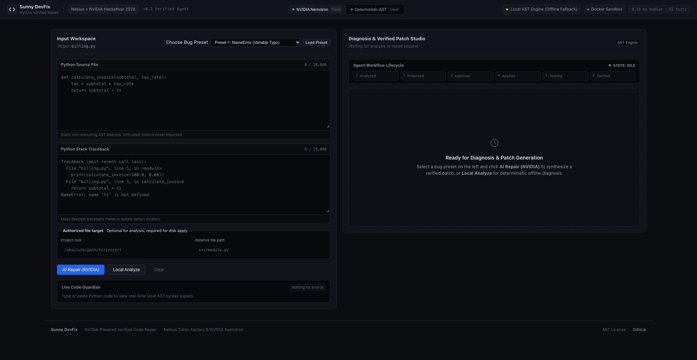
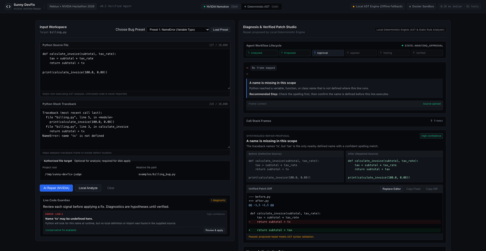
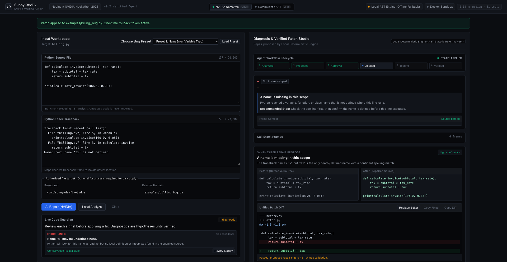
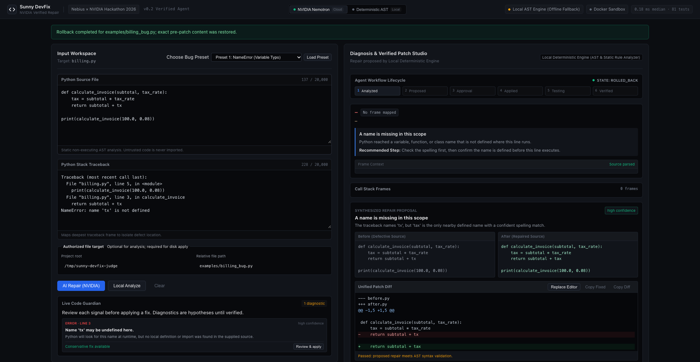
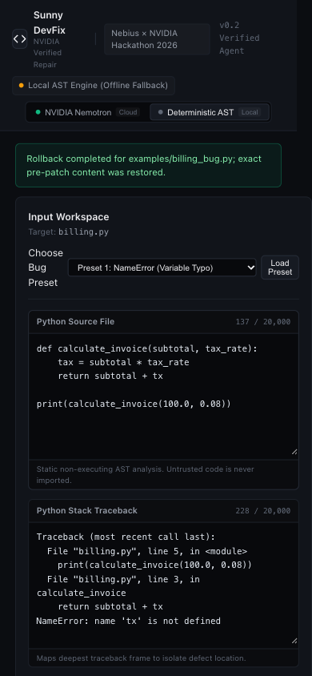
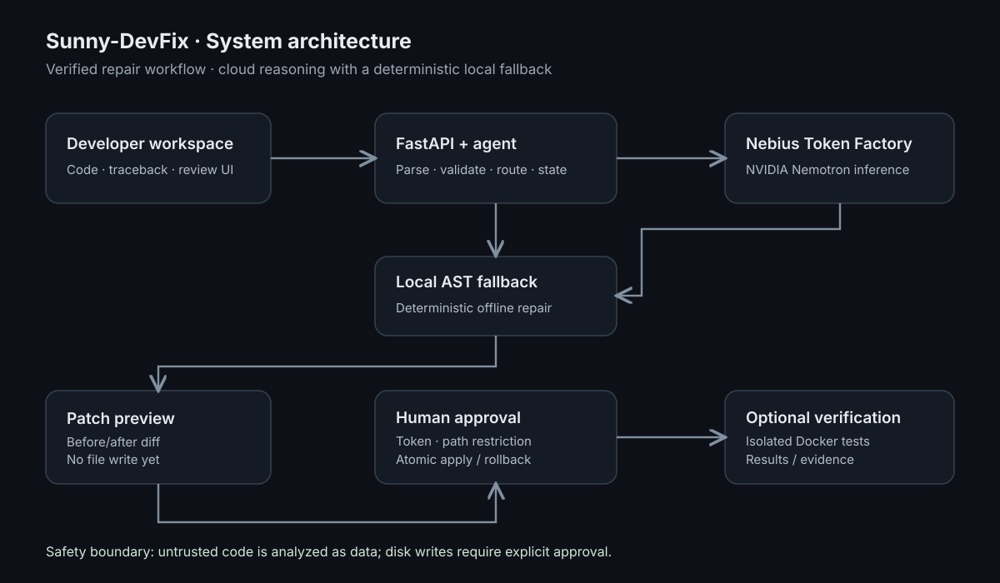

# Sunny-DevFix — NVIDIA-Powered Verified Code Repair

**Nebius × NVIDIA Global AI Hackathon 2026 · Coding and Agentic Engineering**

A Python debugging and repair application with traceback analysis, NVIDIA Nemotron reasoning via Nebius Token Factory, reviewed patch previews, explicit human approval, rollback, and optional isolated verification.

> **Judge build:** The hackathon implementation is on [`feat/nebius-nvidia-verified-repair`](https://github.com/sunny-kavixo/Sunny-DevFix/tree/feat/nebius-nvidia-verified-repair), not this historical `main` branch. Use the [v0.2.0 public release](https://github.com/sunny-kavixo/Sunny-DevFix/releases/tag/v0.2.0) and its [downloadable test archive](https://github.com/sunny-kavixo/Sunny-DevFix/releases/download/v0.2.0/sunny-devfix-v0.2.0.tar.gz) for evaluation.

## Product demo — real application screenshots

These images are captured from the published hackathon feature branch (not mockups). Click a screenshot to view it at full resolution.

### Workspace and root-cause analysis

### Repair proposal and before/after diff

### Explicit patch approval and rollback

| Approved patch | Restored original file |
| :---: | :---: |
|  |  |

### Responsive mobile view

[See all nine original browser captures](https://github.com/sunny-kavixo/Sunny-DevFix/tree/feat/nebius-nvidia-verified-repair/release/screenshots/final_ui)

## System design

[Open diagram at full size](https://github.com/sunny-kavixo/Sunny-DevFix/blob/feat/nebius-nvidia-verified-repair/docs/assets/system-architecture.svg) · [Detailed technical architecture](https://github.com/sunny-kavixo/Sunny-DevFix/blob/feat/nebius-nvidia-verified-repair/docs/hackathon/ARCHITECTURE.md)

## Release and verification

- **NVIDIA model:** `nvidia/Nemotron-3_5-Lightning` via Nebius Token Factory; live synthetic repair previously verified.
- **Safety:** approval required before file writes, patch containment, replay protections, and exact rollback.
- **Testing:** 81 automated tests reported passing; [published GitHub CI succeeded](https://github.com/sunny-kavixo/Sunny-DevFix/actions/runs/40675252918).
- **Release:** [Sunny-DevFix v0.2.0](https://github.com/sunny-kavixo/Sunny-DevFix/releases/tag/v0.2.0) · [SHA-256 checksums](https://github.com/sunny-kavixo/Sunny-DevFix/releases/download/v0.2.0/SHA256SUMS).
- **Quick start and judge instructions:** [Feature-branch README](https://github.com/sunny-kavixo/Sunny-DevFix/blob/feat/nebius-nvidia-verified-repair/README.md) · [Judge testing guide](https://github.com/sunny-kavixo/Sunny-DevFix/blob/feat/nebius-nvidia-verified-repair/docs/hackathon/JUDGE_TESTING_GUIDE.md).

The repository's default `main` branch retains an earlier local-first implementation. The screenshots, diagram, and v0.2.0 judge build above refer to the published hackathon feature branch. A demonstration video and final Devpost submission are managed separately by the project owner.

**License:** MIT.
