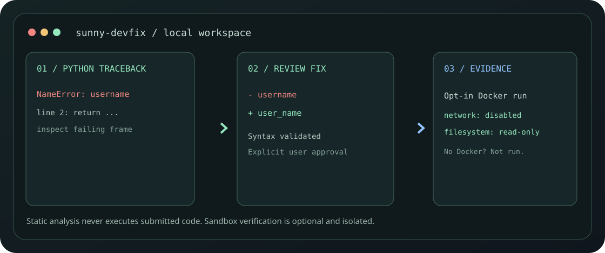

# Sunny-DevFix: NVIDIA-Powered Verified Code Repair

<div align="center">



**Autonomous Python Traceback Debugging · NVIDIA Nemotron on Nebius Token Factory · Cryptographic Approval Gate · Disposable Docker Verification**

[Quick Start](#quick-start) · [Agent Lifecycle](#agentic-workflow-lifecycle) · [Safety Model](#safety--security-boundary) · [Hackathon Documentation](#hackathon-documentation-suite) · [Tests](#testing--verification)

</div>

---

## Overview

**Sunny-DevFix** is an agentic Python traceback debugging and automated repair assistant built for the **Nebius × NVIDIA Global AI Hackathon 2026** under the **Coding and Agentic Engineering** track.

Unlike naive LLM wrappers that emit speculative code snippets without validation or containment, Sunny-DevFix pairs **NVIDIA Nemotron's high-capacity causal reasoning on Nebius Token Factory** with deterministic AST guardrails, single-use cryptographic approval tokens, and zero-trust disposable Docker containers.

---

## Key Features

1. **NVIDIA Nemotron Causal Reasoning on Nebius Token Factory**:
   - Routes bounded traceback stacks and source code to `nvidia/Llama-3.1-Nemotron-70B-Instruct` (or `nebius/nvidia/Nemotron-3-Ultra-550b-a55b`).
   - Enforces strict Pydantic JSON schemas (`root_cause_title`, `explanation`, `recommended_next_step`, and `repaired_source`).
2. **6-Stage Agentic Workflow Lifecycle**:
   - `ANALYZED` → `PATCH_PROPOSED` → `AWAITING_APPROVAL` → `APPLIED` → `TESTING` → `VERIFIED` (or `ROLLED_BACK`).
3. **Human-in-the-Loop Cryptographic Approval Gate**:
   - Zero silent file modifications: writes require an operator-reviewed preview and a 5-minute single-use cryptographic approval token.
   - Atomic disk writes preserve file permissions and prevent partial write corruptions.
4. **Single-Click Fail-Safe Rollback**:
   - Every applied patch issues a one-time rollback token. If regressions occur, clicking **Instant Rollback** immediately restores exact pre-patch bytes.
5. **Disposable Docker Evidence Sandbox**:
   - Before-and-after reproductions run in parallel disposable containers with `--network none`, `--read-only`, dropped capabilities, memory caps, and a non-root UID.
   - Generates an objective scorecard verifying syntax, reproduction pass/fail, and regression detection.
6. **Live Code Guardian**:
   - Instant in-editor AST linter providing debounced, line-level diagnostics as you type, completely offline.
7. **Zero-Cloud Offline Fallback**:
   - If `NEBIUS_API_KEY` is not present, the assistant automatically falls back to its deterministic AST engine with zero crashes or errors.

---

## Agentic Workflow Lifecycle

```
[Defective Code + Traceback]
            │
            ▼
     [ 1. ANALYZED ]  ─── Local AST parse & deepest frame mapping
            │
            ▼
  [ 2. PATCH PROPOSED ] ─── NVIDIA Nemotron on Nebius Token Factory
            │
            ▼
 [ 3. AWAITING APPROVAL ] ── Side-by-side diff & 5-minute token issued
            │
            ├── User Denies / Aborts ──► FAILED (No disk write)
            │
            ▼ User Approves
      [ 4. APPLIED ]  ──── Atomic write to disk & rollback token issued
            │
            ▼ Optional Docker Evidence
      [ 5. TESTING ]  ──── Isolated containers (--network none, --read-only)
            │
            ├─ Reproduction Passes ──► [ 6. VERIFIED ]
            │
            └─ Regression / Revert ──► [ 6. ROLLED_BACK ] (Pre-patch restored)
```

---

## Quick Start

### 1. Requirements
- Python 3.14 (or 3.12+)
- GNU Make
- Docker (optional, for container evidence verification)

### 2. Local Setup
```bash
git clone https://github.com/sunny-kavixo/Sunny-DevFix.git
cd Sunny-DevFix
git checkout feat/nebius-nvidia-verified-repair

# Install pinned dependencies
python3 -m pip install -r requirements.lock -r requirements-dev.lock
```

### 3. Launch Service
```bash
# Run locally (runs 100% offline with deterministic fallback out of the box)
make run

# Or enable live Nebius Token Factory inference:
export NEBIUS_API_KEY="your-nebius-token-factory-key"
export DEVFIX_NEBIUS_ENABLED="true"
make run
```
Open **[http://127.0.0.1:8000](http://127.0.0.1:8000)** in your browser.

---

## Safety & Security Boundary

- **Passive Data Principle**: All submitted Python source and tracebacks are treated as untrusted passive data. Never executed on the host, never imported into the server runtime.
- **Credential Protection**: Server keys (`NEBIUS_API_KEY`) remain strictly on the backend and are masked (`supe...8877`) in diagnostic endpoints.
- **Path Containment**: Disk patches are restricted strictly to explicitly authorized `DEVFIX_PROJECT_ROOTS`. Symlink escapes and directory traversal are rejected.
- **Adversarial Hardening**: Passed 9 dedicated adversarial security tests covering prompt injection, replay attacks, and container isolation.

---

## Testing & Verification

Sunny-DevFix features an exhaustive 80-test test suite across 16 test files:

```bash
# Run the complete test suite
python3 -m pytest

# Result: 80 passed in ~0.8s
```

Run the deterministic benchmark:
```bash
PYTHONPATH=src python3 tools/benchmark.py --iterations 2000
# Median latency: ~0.18ms | Peak memory: ~95 KiB
```

---

## Hackathon Documentation Suite

Detailed compliance, architecture, and verification materials are maintained in `docs/hackathon/`:

- [BASELINE_AUDIT.md](docs/hackathon/BASELINE_AUDIT.md): Initial read-only repository audit and Git baseline.
- [COMPLIANCE_MATRIX.md](docs/hackathon/COMPLIANCE_MATRIX.md): Detailed requirement-by-requirement compliance matrix.
- [ARCHITECTURE.md](docs/hackathon/ARCHITECTURE.md): Technical architecture diagram, state machine, and data flow.
- [SECURITY_MODEL.md](docs/hackathon/SECURITY_MODEL.md): Threat model, prompt injection defense, and cryptographic token lifecycle.
- [TEST_REPORT.md](docs/hackathon/TEST_REPORT.md): Complete report covering Pass A (Baseline), Pass B (Functional), and Pass C (Adversarial).
- [NEW_WORK_CHANGELOG.md](docs/hackathon/NEW_WORK_CHANGELOG.md): Clear separation of pre-existing work from post-August-26 hackathon improvements.
- [MODEL_INTEGRATION_EVIDENCE.md](docs/hackathon/MODEL_INTEGRATION_EVIDENCE.md): Nebius Token Factory & NVIDIA model integration evidence.
- [JUDGE_TESTING_GUIDE.md](docs/hackathon/JUDGE_TESTING_GUIDE.md): Step-by-step evaluator instructions and example bug walkthroughs.
- [DEPLOYMENT_GUIDE.md](docs/hackathon/DEPLOYMENT_GUIDE.md): Cloud Run and Docker deployment instructions with quota protection.
- [DEVPOST_SUBMISSION.md](docs/hackathon/DEVPOST_SUBMISSION.md): Complete Devpost submission text and technology feedback.
- [DEMO_VIDEO_SCRIPT.md](docs/hackathon/DEMO_VIDEO_SCRIPT.md): 2-minute 55-second YouTube video storyboard and narration script.
- [FINAL_RELEASE_CHECKLIST.md](docs/hackathon/FINAL_RELEASE_CHECKLIST.md): Quality gates G1–G15 and owner release action items.

---

## License

Sunny-DevFix is open-source software licensed under the **[MIT License](LICENSE)**.
