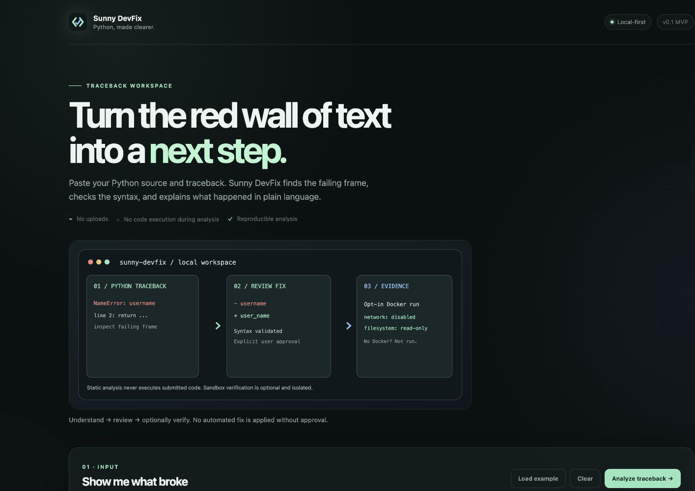
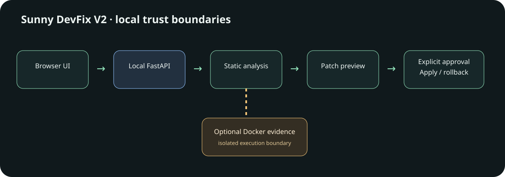
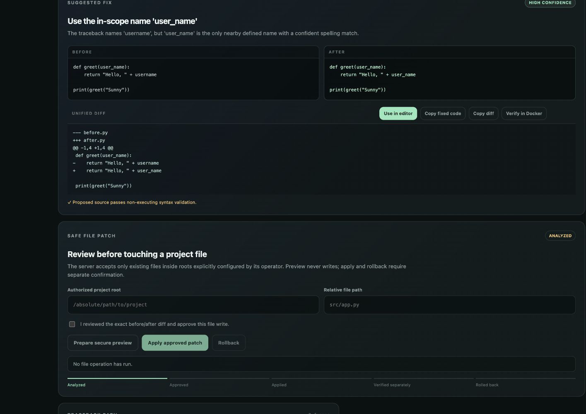
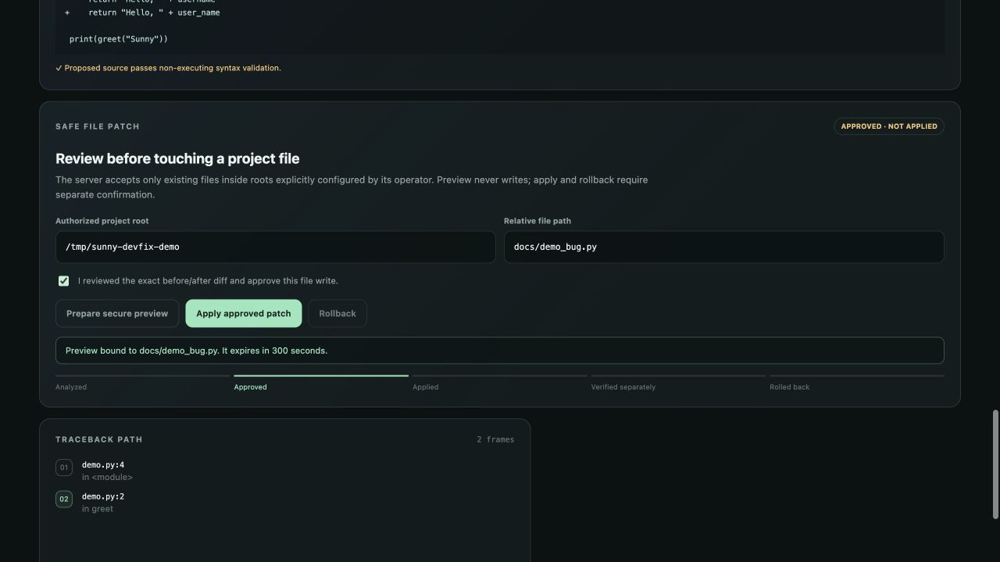
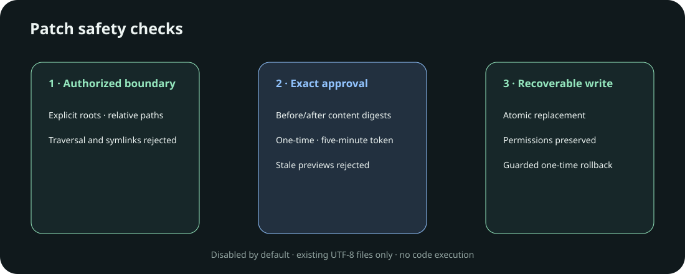

# Sunny DevFix

<div align="center">


**Local-first Python traceback analysis · Conservative fixes · Optional sandbox evidence**

[Quick start](#local-setup) · [Safety boundary](#safety-boundary) · [Tests](#test) · [Architecture](#architecture)

</div>



> Captured from the real local FastAPI application; not a mockup.

Sunny DevFix is a local-first browser-based Python debugging assistant for
understanding tracebacks, learning why an error happened, and reviewing a
small proposed fix before testing it safely.

The project is being built for the **Frontier Buildathon 2026 — Developer
Tools & Open Source** track with OmniRush. The reproducible foundation,
deterministic traceback/source-analysis core, FastAPI analysis endpoint, live
guardian diagnostics, conservative fix suggestions, before/after diffs, and
responsive browser workspace are now in place. Explicit Docker evidence is
available as an opt-in local capability.

## Architecture



The browser and editor integrations communicate with the local FastAPI engine. The static-analysis path never executes submitted Python. The separate Docker evidence path runs only after explicit opt-in and when its sandbox prerequisites are met.

## Debugging and patch workflow




After analysis proposes a conservative change, the UI can prepare a secure file
preview against an explicitly authorized project root. Preview does not write.
Apply requires separate confirmation, and a successful write is labeled **applied**,
not **verified**. Rollback is available only while the exact applied content remains.





## What this project does — and does not claim

- **Implemented:** local traceback analysis, line-aware live guardian, reviewed code suggestions, before/after diffs, opt-in Docker evidence, VS Code and Chrome integration prototypes.
- **Not implemented:** general-purpose autonomous coding agent, broad multi-file repository repair, cloud AI model integration, persisted debugging histories, and production-scale performance benchmarks.
- **Performance:** no latency or throughput claim is made without a reproducible benchmark; evaluate cold start, guardian response times, peak RAM, and Docker isolation overhead before publishing figures.

## Safety boundary

Sunny DevFix does not execute submitted Python directly on the host. The
analysis path only parses bounded text and source code. The evidence path uses
an explicitly configured disposable Docker sandbox with no network access, no
host mounts, a read-only filesystem, dropped capabilities, and resource limits.
If those conditions are unavailable, the application reports that sandbox
execution was not performed.

There are no external AI or network services required at runtime.

File writes are disabled unless `DEVFIX_PROJECT_ROOTS` contains the exact project
root. The patch lifecycle uses `POST /api/patches/preview`, `/api/patches/apply`,
and `/api/patches/rollback`. Traversal, symlink escapes, stale content, expired or
replayed tokens, oversized targets, and rollback over newer edits are rejected.

## Requirements

- Python 3.14.5
- GNU Make
- Docker Desktop or Docker Engine for container checks and optional sandboxing

Node.js is not required for the current architecture because the frontend will
use static HTML, CSS, and JavaScript served by the Python application.

## Local setup

Create a project-local virtual environment and install the pinned development
dependencies:

```bash
python3 -m venv .venv
source .venv/bin/activate
python -m pip install --requirement requirements-dev.lock
```

Copy the environment template if you want to customize local settings:

```bash
cp .env.example .env
```

No secret values are required for the current milestone.

## Run

Start the local service with:

```bash
make run
```

Open <http://127.0.0.1:8000/> for the browser workspace. The health endpoint is
available at <http://127.0.0.1:8000/api/health>.

The analysis endpoint accepts bounded source and traceback text:

```text
POST /api/analyze
```

Its response includes the parsed traceback, source syntax validation,
beginner-friendly root-cause guidance, a conservative suggested fix when one
can be determined, the before/after source, and a copyable unified diff. Fixes
are validated with `ast.parse`; submitted source is never imported or executed.

## Live Guardian

The browser workspace sends source changes to `POST /api/guardian` after a
short debounce. The guardian reports line-level syntax errors, likely
undefined names, and guaranteed literal division-by-zero cases with severity
and confidence labels. A quick fix is only applied after the user clicks
**Review & apply** or **Apply fix**; diagnostics alone never modify the editor.

## Evidence Lab

The **Verify in Docker** action is explicit and opt-in. When
`DEVFIX_SANDBOX_ENABLED=true` and the configured local image exists, Sunny
DevFix runs the before and after versions in separate disposable containers
with no network, no host mounts, a read-only filesystem, dropped capabilities,
resource limits, and a timeout. It reports observed exit status, output, timing,
regression status, and an evidence scorecard. A passing isolated reproduction
is evidence for that reproduction only; it does not prove general functional
correctness.

The application container intentionally does not receive the Docker socket.
Therefore Docker evidence is available when the local service can reach the
host Docker CLI, not from the default app container. If the sandbox is not
configured or the image is missing, the UI reports that evidence was not run.

## VS Code integration

`extensions/sunny-devfix-vscode` contains a dependency-free Python integration
prototype that is wired to the live guardian endpoint. It debounces document
changes, publishes Problems-panel diagnostics, and exposes fixes as normal
user-approved Quick Fix code actions. It requires the local engine at
`http://127.0.0.1:8000` by default; source is not sent to a cloud service.
The repository checks the extension manifest and JavaScript syntax, but a VS
Code Extension Development Host is not available in the offline test image.

## Test

The single project test command is:

```bash
make test
```

The test suite is designed to run without internet access after dependencies
have been installed into the project virtual environment.

CI runs the suite on every pull request. See the
[GitHub Actions workflow](https://github.com/sunny-kavixo/Sunny-DevFix/actions/workflows/ci.yml).

## Verified local performance

Three 2,000-iteration static-analysis runs on Apple Silicon with CPython 3.14.5
recorded median latency of 0.1878–0.1920 ms, p95 of 0.2045–0.2659 ms, and
94.9 KiB peak traced Python allocation. These development measurements exclude
HTTP, browser, Docker, and filesystem latency; see `docs/performance.md`.

## Limitations and roadmap

- Approval and rollback tokens are process-local and expire after five minutes.
- Patch writes support existing regular UTF-8 files up to 20,000 bytes.
- Docker evidence is unavailable unless explicitly configured locally.
- Suggestions cover conservative deterministic cases, not arbitrary repository repair.
- Planned work includes local history/export and broader browser interaction coverage.

Focused contributions are welcome under the repository's [MIT License](LICENSE).

## Docker

Build the project image:

```bash
docker build --tag sunny-devfix:local .
```

Run the service:

```bash
docker run --rm --publish 8000:8000 sunny-devfix:local
```

Run the tests in the image with networking disabled and a temporary writable
directory for test tooling:

```bash
docker run --rm --network none --read-only \
  --tmpfs /tmp:rw,nosuid,nodev,size=64m \
  sunny-devfix:local make test
```

The Docker daemon must be running for these commands. A Docker client being
installed is not enough.

## Rebuild checklist

- `.python-version` pins the Python runtime.
- `requirements.lock` and `requirements-dev.lock` pin dependencies.
- `Dockerfile` installs system and Python dependencies inside the image.
- `Makefile` provides the single offline test command.
- `.env.example` documents configuration without storing secrets.
- The project contains no machine-specific absolute paths.
- Git history should contain focused commits after each working milestone.

## Project layout

```text
src/sunny_devfix/  application and analysis code
tests/             offline behavior tests and fixtures
Dockerfile         clean Linux build and run instructions
Makefile           run and test commands
requirements*.lock pinned Python dependencies
```

## Buildathon submission notes

The final submission should use a public GitHub repository from the connected
account, identify the Developer Tools & Open Source track, and include the
OmniRush sessions used to build the project. A short demo video and live link
are optional but recommended by the event guide. Keep secrets, credentials, and
private files out of the project folder because the project history and
sessions are part of the review process.
