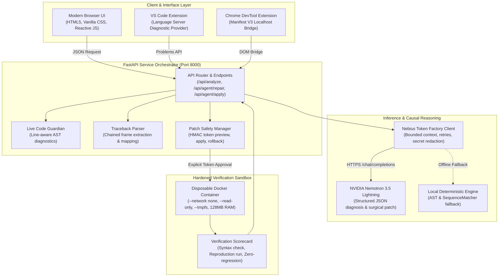

# Sunny-DevFix Architecture: NVIDIA-Powered Verified Code Repair

**Hackathon Track:** Coding and Agentic Engineering  
**Version:** 0.2.0 (Verified Agentic Repair)  
**License:** MIT  

---

## 1. System Overview

Sunny-DevFix is an agentic Python traceback debugging and automated repair assistant designed for developers, teams, and high-reliability CI pipelines. Unlike naive LLM code generators that output speculative patches without testing or guardrails, Sunny-DevFix couples **NVIDIA Nemotron's high-capacity causal reasoning on Nebius Token Factory** with a hardened, multi-stage verification architecture.

---

## 2. Key Architecture Components

### A. The Agentic State Machine (`src/sunny_devfix/agent.py`)
The repair agent moves through explicit, verifiable states:
1. **`ANALYZED`**: Traceback frames are parsed into file, line, function, and expression context. Target lines are cross-referenced against the submitted AST without importing or running untrusted code.
2. **`PATCH_PROPOSED`**: Bounded context is transmitted to NVIDIA Nemotron on Nebius Token Factory. The model produces a strictly validated Pydantic JSON structure containing root-cause analysis, actionable next steps, and a minimal surgical repair.
3. **`AWAITING_APPROVAL`**: The proposed code is diffed. A 5-minute cryptographic approval token is generated, binding the patch to the exact SHA-256 before/after bytes and target workspace file.
4. **`APPLIED`**: When the human operator confirms the change, an atomic same-directory filesystem swap writes the file and issues a one-time rollback token.
5. **`TESTING`**: If reproduction code/input is provided, both before and after versions execute in separate disposable Docker containers under zero-trust constraints (`--network none`, `--read-only`, non-root user).
6. **`VERIFIED` / `ROLLED_BACK`**: If reproduction passes without regression, the state transitions to `VERIFIED`. If a regression is detected or the user clicks revert, the single-use rollback token immediately restores pre-patch bytes (`ROLLED_BACK`).

### B. Nebius Token Factory Client (`src/sunny_devfix/providers/nebius.py`)
- **Protocol**: OpenAI-compatible API at `https://api.tokenfactory.nebius.com/v1/chat/completions`.
- **Verified model**: `nvidia/Nemotron-3_5-Lightning`.
- **Safety**:
  - Zero browser exposure: all keys reside strictly in the server environment (`NEBIUS_API_KEY`).
  - Key presence is reported only as `[REDACTED]` in diagnostic endpoints and logs.
  - Character bounding (payloads capped at 30,000 characters).
  - Exponential backoff with jitter on HTTP 429 and 5xx responses.
  - Seamless offline fallback to the local deterministic AST analyzer if credentials are missing or unavailable.

### C. Live Code Guardian (`src/sunny_devfix/analysis/guardian.py`)
- Operates in real-time as the developer types (debounced to 420ms).
- Performs purely local AST analysis to catch syntax errors, missing colons, undefined names, and division by zero.
- Emits line-level diagnostics with severity (`error`, `warning`) and confidence metrics without server roundtrips or code execution.

### D. Hardened Docker Evidence Sandbox (`src/sunny_devfix/sandbox.py`)
When container verification is enabled:
- Network isolation: `--network none`
- Filesystem safety: `--read-only` root with a minimal 16MB `--tmpfs /tmp`
- Capability stripping: `--cap-drop ALL`, `--security-opt no-new-privileges`
- Resource limits: 128MB memory cap, 0.5 CPU cap, 64-process PID limit
- Non-root user: `65532:65532` (nobody/nogroup)
- Timeouts: 4.0 second strict cutoff
